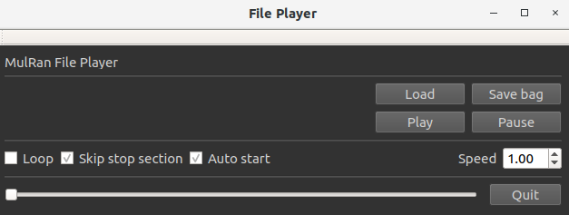

# File player for MulRan dataset

Maintainer: Giseop Kim (paulgkim@kaist.ac.kr)

This program is a file player for the [MulRan dataset](https://sites.google.com/view/mulran-pr/home). 

## NEWS
### Update: ROS 2 port
- The package now builds against ROS 2 (developed and tested on Jazzy) with `ament_cmake` / `colcon`.
- Topics, message types and frame ids are unchanged from the ROS 1 version; `/imu/mag` (`sensor_msgs/msg/MagneticField`) is now actually advertised.
- 'Save bag' writes a **rosbag2** bag (a directory, `<sequence>/output`, mcap by default) instead of a single `.bag` file.

### Update (2023. 08. 11): ros noetic compatability 
- We now support compiling in the ros noetic environment. Instructions for installing from noetic can be found in the section below. 
  
### Update (2021. 08. 03): rosbag generation 
- We now support to generate a rosbag from the files. This is a contribution from [Daniel Adolfsson](https://github.com/dan11003) and we are very grateful for his efforts (for the details: see [The pull requests from @dan11003](https://github.com/irapkaist/file_player_mulran/pull/7))
- Use the 'Save bag' button. <p align="center"></p>
- Note
  - Currently only Radar files are saved into a rosbag with ground-truth trajectory (not body frame, but UTM coordinate) as Odometry topic. Later, we plan to support lidar, imu, and gps topics as well as the radar files in a single rosbag.


### Update (2020. 11. 19): IMU and GPS are available 
- We released IMU and GPS data (consumer-level), as well as the originally delivered LiDAR and radar data. 
  - The model specification and the extrinsic calibration (i.e., the sensor position within our car platform) is equivalent to our lab's other dataset ([Complex Urban Dataset, IJRR 19](https://irap.kaist.ac.kr/dataset/)), so please refer the paper. 
- We expect these data supports [GPS-aided radar researches](https://arxiv.org/pdf/2006.02108.pdf), LiDAR-IMU fusion such as [LIO-SAM](https://github.com/TixiaoShan/LIO-SAM) ([example video](https://youtu.be/Y6DXlC34qlc?t=479)), or radar-imu fusion.

## How to install (ROS 2)
```
$ mkdir -p ros2_ws/src
$ cd ros2_ws/src
$ git clone https://github.com/irapkaist/file_player_mulran.git
$ cd ..
$ rosdep install --from-paths src --ignore-src -r -y
$ colcon build --symlink-install
```
- Dependencies: `rclcpp`, `cv_bridge`, `pcl_conversions`, `rosbag2_cpp`, `tf2_eigen`, PCL, OpenCV and Qt5 (`qtbase5-dev`).

### ROS 1
- For ROS 1, use the `master` branch (melodic) or the `noetic` branch and build with `catkin_make`.

## How to use 

```
$ source install/setup.bash
$ ros2 launch file_player file_player.launch.py
```
- Then, you need to select a sequence directory via GUI.
- The player publishes `/clock`, so start the nodes that consume the data with `use_sim_time` enabled:
```
$ ros2 run <your_pkg> <your_node> --ros-args -p use_sim_time:=true
```
- For the correct load, first you need to place the GPS, IMU, LiDAR, and radar files in a directory following this structure (see this [guide video](https://youtu.be/uU-FC-GmHXA?t=45)) 
- IMU and GPS files (.csv) must be located at the same directory of "data_stamp.csv"

## Published topics

| Topic | Type | Frame |
| --- | --- | --- |
| `/clock` | `rosgraph_msgs/msg/Clock` | - |
| `/gps/fix` | `sensor_msgs/msg/NavSatFix` | `gps` |
| `/imu/data_raw` | `sensor_msgs/msg/Imu` | `imu` |
| `/imu/mag` | `sensor_msgs/msg/MagneticField` | `imu` |
| `/os1_points` | `sensor_msgs/msg/PointCloud2` | `ouster` |
| `/radar/polar` | `sensor_msgs/msg/Image` (mono8) | `radar_polar` |

Playback can also be driven remotely (when 'Auto start' is checked):
```
$ ros2 topic pub --once /file_player_start std_msgs/msg/Bool "{data: true}"
$ ros2 topic pub --once /file_player_stop  std_msgs/msg/Bool "{data: true}"
```


## Contributors
- Jinyong Jeong: The original author
- Minwoo Jung: made the player system compatible with LIO-SAM input (i.e., supports ring information of a lidar scan)
 
